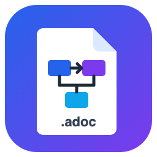
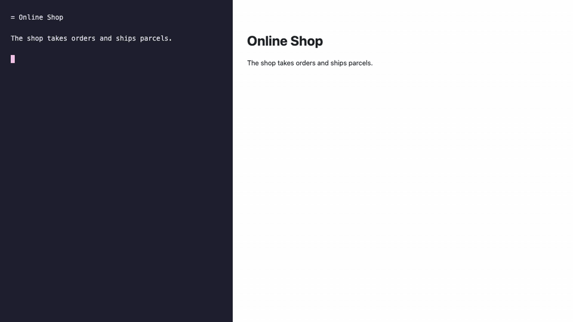
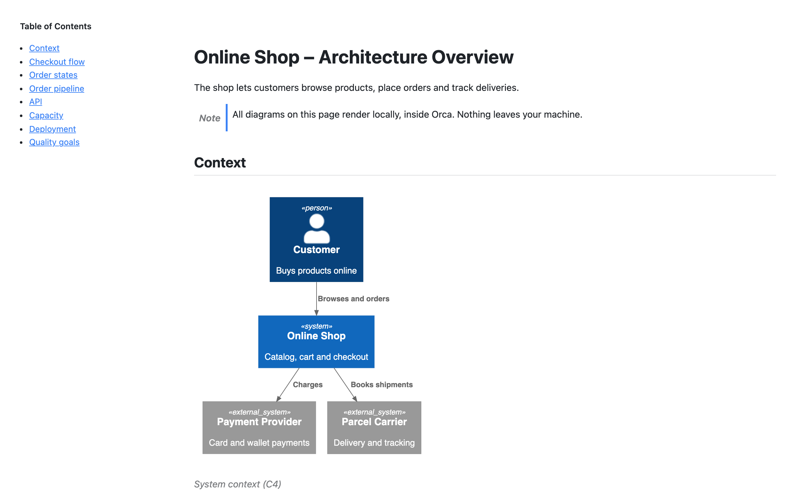
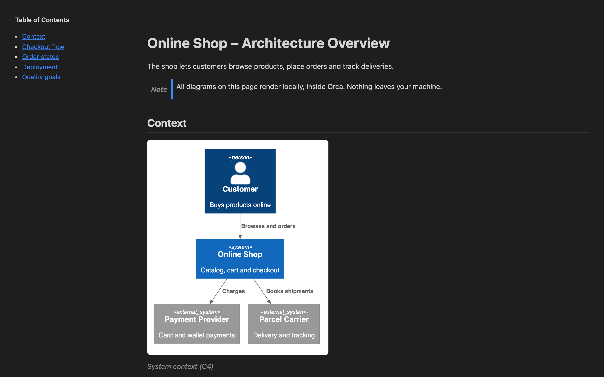

<div align="center">



# AsciiDoc Preview – Diagrams, Code & Math

**Live AsciiDoc preview for [Orca](https://github.com/stablyai/orca), with PlantUML and Mermaid diagrams, rendered fully offline.**

[](https://github.com/schowave/orca-asciidoc-diagrams/actions/workflows/ci.yml)
[](LICENSE)
[](https://github.com/stablyai/orca)



</div>

## Why

Architecture docs often live in AsciiDoc, as in arc42 or docs-as-code, with diagrams inline. This plugin shows those documents in Orca the way Asciidoctor and IntelliJ do, with the diagrams rendered:

- **No server, no Java, no Kroki.** PlantUML and Mermaid run inside Orca's plugin sandbox, so your diagram sources never leave your machine.
- **Same syntax as [asciidoctor-diagram](https://docs.asciidoctor.org/diagram-extension/latest/).** Files keep rendering in Asciidoctor, IntelliJ and GitLab.
- **Live.** The preview follows your edits, including unsaved ones.

## Features

- Opens `.adoc`, `.asciidoc` and `.asc` files in a **Preview** view. Toggle to **Source** in the editor tab to edit.
- [Asciidoctor.js](https://github.com/asciidoctor/asciidoctor.js) 4 renders the document: sections, tables, admonitions, lists, source blocks and more.
- PlantUML with the official JS engine and these bundled standard libraries:
  - **C4** and **ArchiMate**
  - **tupadr3**: Font Awesome, Devicons, Material and more
  - **logos** and **office**
  - **azure**
  - **kubernetes** and **k8s**
  - **eip**
  - **DomainStory**
- Mermaid 12: flowcharts, sequence, state, class, ER, Gantt, mindmaps and more.
- Graphviz (`[graphviz]`, with `layout=` such as `neato` or `circo`), via viz.js.
- Syntax highlighting for source blocks with highlight.js, which covers the common languages.
- Math with `:stem:`: `latexmath` and `asciimath`, inline and as blocks, rendered by KaTeX.
- Every renderer loads only when a document uses it.
- Follows Orca's light and dark theme.
- Wide diagrams scale to fit the page.
- A broken diagram shows an error box with its source. The rest of the document still renders.
- `:toc:` renders a table of contents. `:toc: left` and `:toc: right` render it as a sticky sidebar. In-document links scroll to their target.

## Usage

Write diagram blocks the asciidoctor-diagram way:

```asciidoc
.System context
[plantuml]
----
!include <C4/C4_Context>
Person(customer, "Customer")
System(shop, "Online Shop")
Rel(customer, shop, "Orders")
----

[mermaid]
----
stateDiagram-v2
  [*] --> Placed
  Placed --> Shipped
----

[graphviz]
----
digraph { Order -> Payment -> Shipping }
----

:stem: latexmath
The area is stem:[\pi r^2].
```

- `@startuml` / `@enduml` are optional.
- `[source,plantuml]` is shown as code, not rendered.

<table><tr>
<td></td>
<td></td>
</tr></table>

## Installation

Requires **Orca 1.4.245 or newer**.

### From the Orca plugin directory

**[Open in Orca](https://onorca.dev/plugins/schowave.asciidoc-diagrams?catalog=community)**: the link opens the plugin's page in Orca under Settings → Plugins; press **Install**. Updates install automatically.

### From the Git URL

In Orca:

1. Settings → Plugins → install a plugin
2. Choose **Git URL**
3. Enter the repository URL with a release tag, for example `https://github.com/schowave/orca-asciidoc-diagrams#v1.0.0`. The newest tag is on the [releases page](https://github.com/schowave/orca-asciidoc-diagrams/releases)

Orca marks plugins installed this way as *Unverified*, and they update only when you click **Update**.

### From source

```sh
git clone https://github.com/schowave/orca-asciidoc-diagrams
cd orca-asciidoc-diagrams
npm ci
npm run build          # writes editor/index.html and mirrors the plugin to dist/plugin
```

Then, in Orca:

1. Settings → Plugins → **Turn on plugins**
2. **Development folders…** → add `dist/plugin`
3. Enable the plugin and open an `.adoc` file

> Orca may not pick up a rebuild while a document is open. Reopen the tab, or remove and re-add the folder.

## Limitations

The preview runs in Orca's sandboxed plugin frame, which has no file system, no network and no WebAssembly. That causes these limitations:

| What | Behavior |
|---|---|
| `include::` | Shown as a placeholder naming the file |
| Relative or remote images | Shown as a placeholder with alt text and path. `data:` images work |
| PlantUML `!include` of local files | Not supported |
| Other PlantUML stdlib libraries | An error box says the library is not bundled. You can build the plugin with your own selection; see [Custom library selection](#custom-library-selection) |
| External links, `xref:` to other files | The target is shown as a tooltip, but they are not clickable |
| Raw HTML (`++++` passthrough) | Rendered, with scripts and event handlers removed |
| PlantUML layout | Uses Smetana, because Graphviz is unavailable. Complex graphs can lay out differently from `dot` |

Why some PlantUML stdlib libraries are not in the default build:

- **AWS** (`awslib14`) is too large for Orca's 10 MiB plugin page limit.
- **gcp**, **elastic** and **edgy** declare no license, so they are not redistributed.

### Custom library selection

You can build the plugin with exactly the PlantUML stdlib libraries you need, for example AWS icons in place of the default set:

```sh
export PLANTUML_STDLIB=c4,awslib14      # stdlib folder names, lower-case
node scripts/fetch-stdlib.mjs           # vendors the selected libraries
npm run build                           # dist/plugin now contains your selection
```

Then load `dist/plugin` as a development folder, as described in [From source](#from-source). The names are the folder names in [plantuml-stdlib](https://github.com/plantuml/plantuml-stdlib/tree/master/stdlib). The build fails if the page grows beyond 9.5 MiB: Orca's limit is 10 MiB, and the default build is about 7 MiB. AWS alone adds about 3 MiB.

## How it works

Orca hosts custom editors in a sandboxed iframe. Its CSP allows only inline scripts and blocks `eval`, WebAssembly, `fetch` and workers. So the build produces **one self-contained HTML file**:

- Asciidoctor.js, DOMPurify and the preview code are bundled with esbuild and embedded gzip-compressed. A tiny bootstrap inflates them with the browser's `DecompressionStream`.
- The PlantUML engine, Mermaid, Graphviz, highlight.js, KaTeX with its fonts, and the stdlib bundles are embedded **brotli-compressed**, which is about 25 % smaller than gzip. A pure-JS decoder unpacks each one only when a document first needs it.
- The result is a single file of about 7 MiB.
- The rendered HTML is sanitized, so a script in a foreign `.adoc` file cannot reach Orca's document API.

Design decisions are in [SPEC.md](SPEC.md).

## Development

Tool versions and tasks live in [`mise.toml`](mise.toml), with checksums in `mise.lock`. CI uses the same files, so local and remote builds run on the same Node.

```sh
mise trust && mise run setup   # once: pinned Node and lefthook, npm packages, headless Chromium, git hooks (https://mise.jdx.dev)
mise run check         # fast checks: format, lint, types, TODO rule, unit tests
mise run check-deep    # dead code, duplicate code, dependency licenses (CI runs these too)
mise run test          # build + render the fixtures in headless Chromium inside a replica of Orca's frame
mise run build         # build only: editor/index.html and dist/plugin
mise run media         # regenerate images/ and docs/media/demo.gif from the build
mise tasks             # list all tasks
```

| Path | Content |
|---|---|
| `src/` | The preview: `bootstrap.ts` (startup), `editor.ts`, `payloads.ts` (lazy brotli payloads), `payloads/` (highlight.js and KaTeX entries), `editor.css` |
| `scripts/build.mjs` | Builds `editor/index.html`. It fails above 9.5 MiB, below Orca's 10 MiB limit |
| `tests/unit/` | Unit tests (`*.test.ts`, run by `node --test`) for the pure helpers in `src/text.ts` and `scripts/` |
| `tests/` | Sandbox harness (`orca-frame.mjs`: same sandbox, CSP and click policy as Orca, mocked `window.orca`) and fixtures |
| `vendor/plantuml-stdlib/` | Vendored stdlib bundles, gzipped. The list is in `scripts/stdlib-list.mjs`; refresh with `node scripts/fetch-stdlib.mjs` |
| `orca-plugin.json`, `editor/`, `images/` | The plugin as Orca installs it. `editor/index.html` is committed build output; the release workflow rebuilds and commits it |

Contributions are welcome. Please run `mise run check` and `mise run test`. Leave `editor/index.html` alone: the weekly release workflow rebuilds it. Rules for coding agents are in [AGENTS.md](AGENTS.md).

## License

[MIT](LICENSE) © David Schowalter. Bundled third-party components and their licenses are listed in [THIRD_PARTY_NOTICES.md](THIRD_PARTY_NOTICES.md).

This is a community plugin. It is not affiliated with Orca or Stably.
