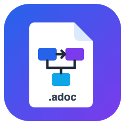
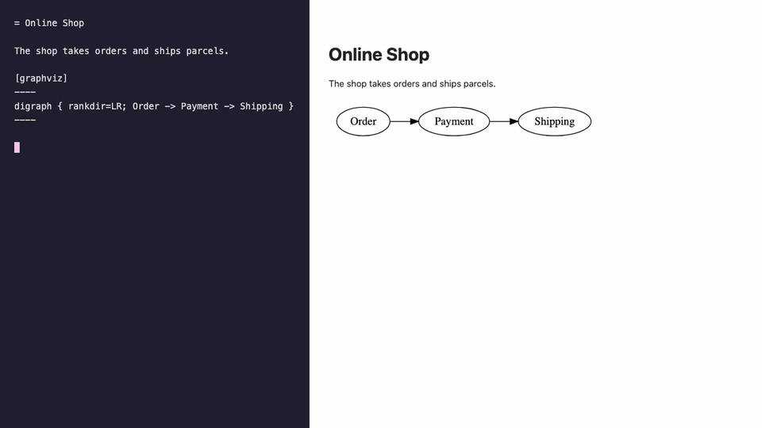
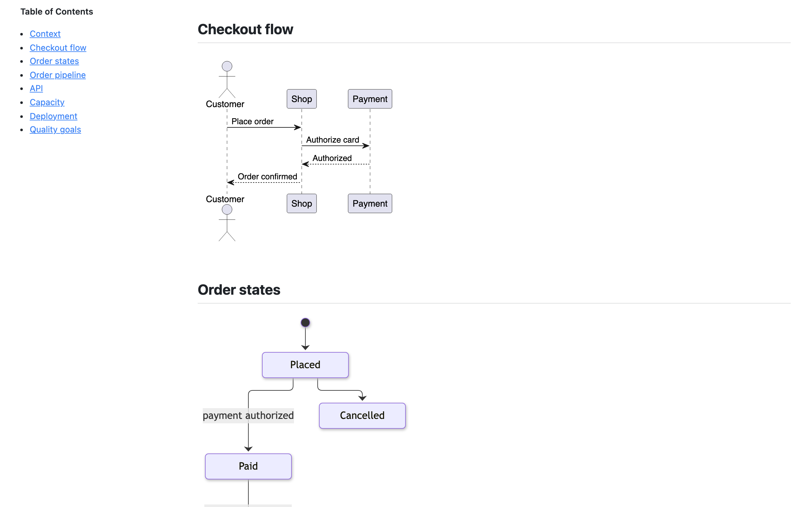
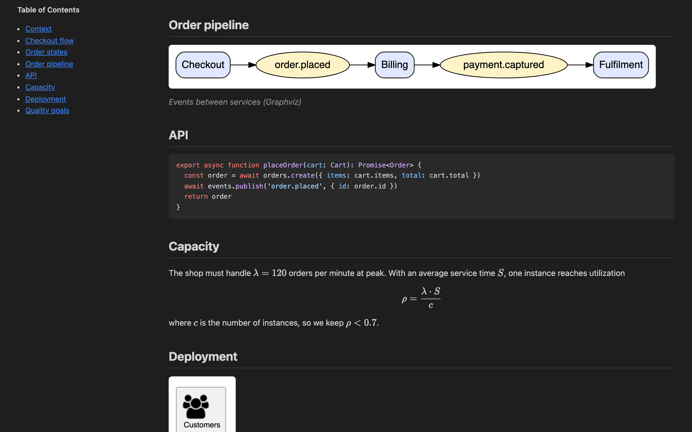

<div align="center">



# AsciiDoc Preview – PlantUML, Mermaid & Graphviz

**Live AsciiDoc preview for [Orca](https://github.com/stablyai/orca), with PlantUML, Mermaid and Graphviz diagrams, rendered fully offline.**

[](https://github.com/schowave/orca-asciidoc-diagrams/actions/workflows/ci.yml)
[](LICENSE)
[](https://github.com/stablyai/orca)
[](https://www.onorca.dev/plugins/schowave/orca-asciidoc-diagrams)
[](CHANGELOG.md)

**[Install in Orca](https://onorca.dev/plugins/schowave.asciidoc-diagrams?catalog=community)** · [Plugin page](https://www.onorca.dev/plugins/schowave/orca-asciidoc-diagrams) · [Changelog](CHANGELOG.md)



</div>

## Why

Architecture docs often live in AsciiDoc, as in arc42 or docs-as-code, with diagrams inline. This plugin shows those documents in Orca the way Asciidoctor and IntelliJ do, with the diagrams rendered:

- **No server, no Java, no Kroki.** PlantUML, Mermaid and Graphviz run inside Orca's plugin sandbox, so your diagram sources never leave your machine.
- **Same syntax as [asciidoctor-diagram](https://docs.asciidoctor.org/diagram-extension/latest/).** Files keep rendering in Asciidoctor, IntelliJ and GitLab.
- **Live.** The preview follows your edits, including unsaved ones.

Orca itself previews Markdown and shows Mermaid files. This plugin adds AsciiDoc, with PlantUML (including C4 and the other bundled libraries), Mermaid and Graphviz diagrams inside the document.

## Features

- Opens `.adoc`, `.asciidoc` and `.asc` files in a **Preview** view. Toggle to **Source** in the editor tab to edit.
- [Asciidoctor.js](https://github.com/asciidoctor/asciidoctor.js) 4 renders the document: sections, tables, admonitions, lists, source blocks and more.
- PlantUML with the official JS engine and these bundled standard libraries:
  - **C4** and **ArchiMate**
  - **tupadr3**: Font Awesome, Devicons, Material and more
  - **logos** and **office**
  - **azure**
  - **kubernetes** and **k8s**
  - **eip**
  - **DomainStory**
- Mermaid 12: flowcharts, sequence, state, class, ER, Gantt, mindmaps and more.
- Graphviz (`[graphviz]`, with `layout=` such as `neato` or `circo`), via viz.js.
- Syntax highlighting for source blocks with highlight.js, which covers the common languages.
- Math with `:stem:`: `latexmath` and `asciimath`, inline and as blocks, rendered by KaTeX. As in Asciidoctor, a document without `:stem:` shows the delimiters as text.
- Every renderer loads only when a document uses it.
- Follows Orca's light and dark theme.
- Wide diagrams scale to fit the page.
- A broken diagram shows an error box with its source. The rest of the document still renders.
- `:toc:` renders a table of contents. `:toc: left` and `:toc: right` render it as a sticky sidebar. In-document links scroll to their target.

## Privacy and permissions

Orca's plugin page lists the plugin as *Opens and edits files*, because it is the editor for `.adoc` files. In practice it only reads: the preview never writes to your document; you edit in Orca's **Source** view. It has no network access, so neither the document nor its diagrams leave your machine. The rendered HTML is sanitized, so scripts in a document from someone else do not run. Details are in [SECURITY.md](SECURITY.md).

## Usage

Write diagram blocks the asciidoctor-diagram way:

```asciidoc
.System context
[plantuml]
----
!include <C4/C4_Context>
Person(customer, "Customer")
System(shop, "Online Shop")
Rel(customer, shop, "Orders")
----

[mermaid]
----
stateDiagram-v2
  [*] --> Placed
  Placed --> Shipped
----

[graphviz]
----
digraph { Order -> Payment -> Shipping }
----

:stem: latexmath
The area is stem:[\pi r^2].
```

- `@startuml` / `@enduml` are optional.
- `[source,plantuml]` is shown as code, not rendered.

<table><tr>
<td></td>
<td></td>
</tr></table>

## Installation

Requires **Orca 1.4.246 or newer**.

### From the Orca plugin directory

**[Open in Orca](https://onorca.dev/plugins/schowave.asciidoc-diagrams?catalog=community)**: the link opens the plugin's page in Orca under Settings → Plugins; press **Install**. Updates install automatically.

The plugin's page in the directory, with screenshots and versions: [onorca.dev/plugins/schowave/orca-asciidoc-diagrams](https://www.onorca.dev/plugins/schowave/orca-asciidoc-diagrams).

### From the Git URL

In Orca:

1. Settings → Plugins → install a plugin
2. Choose **Git URL**
3. Paste the URL of the newest release:

   ```text
   https://github.com/schowave/orca-asciidoc-diagrams#v1.2.2
   ```

   The release workflow updates this URL with every release. Older versions are on the [releases page](https://github.com/schowave/orca-asciidoc-diagrams/releases)

Orca marks plugins installed this way as *Unverified*, and they update only when you click **Update**.

### From source

```sh
git clone https://github.com/schowave/orca-asciidoc-diagrams
cd orca-asciidoc-diagrams
npm ci
npm run build          # writes editor/index.html and mirrors the plugin to dist/plugin
```

Then, in Orca:

1. Settings → Plugins → **Turn on plugins**
2. **Development folders…** → add `dist/plugin`
3. Enable the plugin and open an `.adoc` file

> Orca may not pick up a rebuild while a document is open. Reopen the tab, or remove and re-add the folder.

## Limitations

The preview runs in Orca's sandboxed plugin frame, which has no file system, no network and no WebAssembly. That causes these limitations:

| What | Behavior |
|---|---|
| `include::` | Shown as a placeholder naming the file |
| Relative or remote images | Shown as a placeholder with alt text and path. `data:` images work |
| PlantUML `!include` of local files | Not supported |
| Other PlantUML stdlib libraries | An error box says the library is not bundled. You can build the plugin with your own selection; see [Custom library selection](#custom-library-selection) |
| External links, `xref:` to other files, links in diagrams | The target is shown as a tooltip, but they are not clickable |
| Raw HTML (`++++` passthrough) | Rendered, with scripts and event handlers removed |
| PlantUML layout | Uses Smetana, because Graphviz is unavailable. Complex graphs can lay out differently from `dot` |

Why some PlantUML stdlib libraries are not in the default build:

- **AWS** (`awslib14`) adds about 2.7 MiB, so it is left out of the default build; a custom build can include it (below).
- **gcp**, **elastic** and **edgy** declare no license, so they are not redistributed.

### Custom library selection

You can build the plugin with exactly the PlantUML stdlib libraries you need, for example AWS icons in place of the default set:

```sh
export PLANTUML_STDLIB=c4,awslib14      # stdlib folder names, lower-case
node scripts/fetch-stdlib.mjs           # downloads the selected libraries
npm run build                           # dist/plugin now contains your selection
```

Then load `dist/plugin` as a development folder, as described in [From source](#from-source). The names are the folder names in [plantuml-stdlib](https://github.com/plantuml/plantuml-stdlib/tree/master/stdlib). The build fails if the page grows beyond 9.5 MiB: Orca's limit is 10 MiB, and the default build is about 6 MiB. AWS alone adds about 2.7 MiB.

## Troubleshooting

| Problem | What to do |
|---|---|
| A diagram shows "library … is not bundled" | The PlantUML stdlib library is not in the default build. Build your own selection ([Custom library selection](#custom-library-selection)) or [ask for it](https://github.com/schowave/orca-asciidoc-diagrams/issues/new/choose) |
| Math shows as `\(…\)` or `\$…\$` | Set `:stem:` (or `:stem: latexmath`) in the document header |
| A `.adoc` file opens as text, not as a preview | Switch the tab's view to **Preview**, and check that the plugin is enabled under Settings → Plugins |
| A PlantUML diagram looks different from IntelliJ | The preview uses PlantUML's Smetana layout, because Graphviz `dot` cannot run in the sandbox |
| A rebuild from source does not show up | Reopen the tab, or remove and re-add the development folder |

## How it works

Orca hosts custom editors in a sandboxed iframe. Its CSP allows only inline scripts and blocks `eval`, WebAssembly, `fetch` and workers. So the build produces **one self-contained HTML file**:

- Asciidoctor.js, DOMPurify and the preview code are bundled with esbuild and embedded gzip-compressed. A tiny bootstrap inflates them with the browser's `DecompressionStream`.
- The PlantUML engine, Mermaid, Graphviz, highlight.js, KaTeX with its fonts, and the stdlib bundles are embedded **brotli-compressed**, which is about 25 % smaller than gzip. A pure-JS decoder unpacks each one only when a document first needs it.
- Everything is stored as base-122 text, which adds about 14 % (base64 would add 33 %). The result is a single file of about 6 MiB.
- The rendered HTML is sanitized, so a script in a foreign `.adoc` file cannot reach Orca's document API.

Design decisions are in [SPEC.md](SPEC.md).

## Contributing

Bug reports and pull requests are welcome: see [CONTRIBUTING.md](CONTRIBUTING.md) for the development setup and checks. Security issues go through [SECURITY.md](SECURITY.md).

## License

[MIT](LICENSE) © David Schowalter. Bundled third-party components and their licenses are listed in [THIRD_PARTY_NOTICES.md](THIRD_PARTY_NOTICES.md).

This is a community plugin. It is not affiliated with Orca or Stably.
